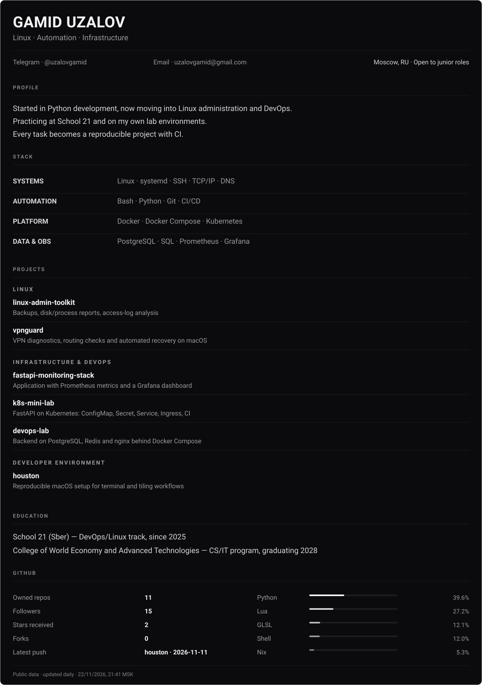

  

  
  
  
  

## What I build

I turn backend and infrastructure exercises into reproducible projects with documentation, automation and CI. My current focus is Linux administration, Python backends, containers, Kubernetes and observability.

| Project | What it demonstrates |
| --- | --- |
| [devops-lab](https://github.com/Uzalov-Gamid/devops-lab) | FastAPI, PostgreSQL, Redis, nginx, Docker Compose and CI |
| [vpnguard](https://github.com/Uzalov-Gamid/vpnguard) | macOS VPN diagnostics, routing checks and automated recovery |
| [fastapi-monitoring-stack](https://github.com/Uzalov-Gamid/fastapi-monitoring-stack) | Prometheus metrics, Grafana provisioning and containerized monitoring |
| [k8s-mini-lab](https://github.com/Uzalov-Gamid/k8s-mini-lab) | Kubernetes workloads, ConfigMap, Secret, Service, Ingress and CI |
| [linux-admin-toolkit](https://github.com/Uzalov-Gamid/linux-admin-toolkit) | Backups, disk/process reports and access-log analysis |
| [houston](https://github.com/Uzalov-Gamid/houston) | Reproducible macOS terminal and tiling-window environment |

## Current direction

- Building production-shaped backend and infrastructure labs.
- Improving Linux, networking, Kubernetes and CI/CD fundamentals.
- Studying at School 21 and completing a CS/IT college program.
- Open to junior DevOps, Linux administration and backend opportunities.

  
<strong>Core toolbox</strong>

   

  `Linux` · `Bash` · `Python` · `FastAPI` · `Django` · `PostgreSQL` · `Docker` · `Kubernetes` · `GitHub Actions` · `Prometheus` · `Grafana`

---

The profile card is generated daily from public GitHub data by <a href="./scripts/generate-profile.mjs">this repository's workflow</a>.
